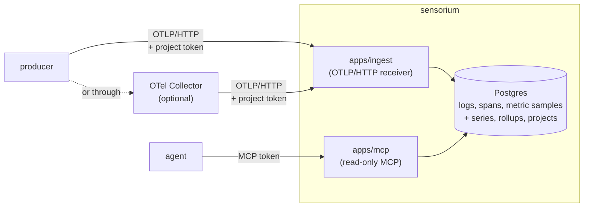

<!-- 翻译自 README.md @ docs/readme-template-v2。只翻译 "For AI agents" 之前的章节，英文版更新时一起改。 -->

<div align="center">

<h1>sensorium</h1>

<p><strong>给 agent 用的可观测性：OpenTelemetry 进，MCP 出。</strong></p>

[](https://github.com/zyx1121/sensorium/actions)
[](https://github.com/zyx1121/sensorium/pkgs/container/sensorium)
[](https://sensorium.zyx.tw)
[](LICENSE)

[English](README.md) | [繁體中文](README.zh-TW.md) | **简体中文**

</div>

```console
$ error_summary { "project": "reel", "windowMinutes": 1440 }
{"project": "reel", "windowMinutes": 1440, "errorLogCount": 1, "errorSpanCount": 0, "topMessages": [{"body": "round failed", "count": 1}]}
```

你的服务早就会发送 OpenTelemetry，但凌晨三点读日志的，越来越常是 agent，而不是盯着仪表盘的人。sensorium 把许多服务的日志、trace 和 metric 存在同一个 Postgres，再通过 MCP 交给 agent。“哪里坏了？”变成一次工具调用。

## 功能

- **接收 OpenTelemetry**：在 `/v1/logs`、`/v1/traces` 和 `/v1/metrics` 接收 OTLP over HTTP，JSON 或 protobuf 都可以。
- **项目彼此隔离**：每个项目有自己的写入令牌，由令牌决定数据写到哪里。
- **回答 agent**：在 `/mcp` 提供 8 个只读的 MCP 工具。
- **自动清理旧数据**：默认原始 metric 保留 14 天，5 分钟 metric 汇总保留 90 天，span 和日志保留 30 天。

## 快速开始

```sh
curl -fsSLO https://raw.githubusercontent.com/zyx1121/sensorium/main/compose.yaml
curl -fsSL -o .env https://raw.githubusercontent.com/zyx1121/sensorium/main/.env.example
# 在 .env 设置 POSTGRES_PASSWORD 和 SENSORIUM_MCP_TOKEN，例如用 `openssl rand -hex 32` 生成
docker compose up -d
```

这会启动 Postgres 并应用 schema，同时从 `ghcr.io/zyx1121/sensorium` 运行 8787 端口的接收端、8788 端口的 MCP 端点，以及每 24 小时一次的清理任务。

> [!IMPORTANT]
> 两个端口都只监听 127.0.0.1，令牌放在 Authorization 请求头里传送。在机器外的任何东西连进来之前，前面要先放一个带 TLS 的反向代理。

两个端点共用一个域名时，代理把 `/mcp`（用 OAuth 时还有 `/.well-known/oauth-protected-resource`）发到 8788，其他都发到 8787。Caddy 的写法：

```caddyfile
sensorium.example.com {
	handle /mcp* /.well-known/oauth-protected-resource* {
		reverse_proxy 127.0.0.1:8788
	}
	handle {
		reverse_proxy 127.0.0.1:8787
	}
}
```

不用 Docker 的话，[deploy/](deploy/) 有给 Bun 加本地 Postgres 用的 systemd unit。

## 使用方法

1. 注册项目。令牌只会打印一次，对同一个名称再运行一次会轮换令牌。

   ```sh
   docker compose run --rm ingest register-project my-service
   ```

2. 把服务的 OpenTelemetry exporter 指向 sensorium：

   ```sh
   OTEL_EXPORTER_OTLP_ENDPOINT=https://sensorium.example.com
   OTEL_EXPORTER_OTLP_PROTOCOL=http/protobuf
   OTEL_EXPORTER_OTLP_HEADERS=Authorization=Bearer%20<ingest token>
   ```

   sensorium 收 OTLP/HTTP，未压缩或 gzip 都可以，但不收 gRPC。只会发送 gRPC 的 exporter，前面要放一个 OpenTelemetry Collector，参考 [collector/](collector/)。

3. 连接 agent：

   ```sh
   claude mcp add --transport http sensorium https://sensorium.example.com/mcp \
     --header "Authorization: Bearer <SENSORIUM_MCP_TOKEN>"
   ```

4. 问它哪里坏了。通常先调用 `error_summary` 和 `top_sources`。

| 工具 | 返回 |
|------|------|
| `list_projects` | 所有项目和最后活动时间 |
| `query_logs`、`query_traces`、`list_traces` | 可筛选的日志、span 和完整 trace |
| `error_summary` | 错误日志和错误 span 的数量，以及最常出现的消息 |
| `top_sources` | 最常出现的客户端、国家和路由 |
| `query_metrics` | 按名称查询 metric 数据点，或用 `step` 取每个 series 的区间汇总 |
| `search` | 在日志和 span 里做文字搜索 |
| `agent_usage` | 从 `gen_ai.*` span 算出每个模型与工具的 token、调用、错误与延迟 |
| `storage_stats` | 数据库大小、分区，以及没有数据或被拒收的项目 |

每个工具都是只读，并返回结构化内容。服务器的数据库连接也是只读。

`GET /ready`（ingest 与 MCP）只在数据库有响应时返回 200。`GET /health` 只代表进程还活着。

## 配置

在 `.env` 设置这些值，[.env.example](.env.example) 有每一项的说明。

| 参数 | 作用 | 默认值 |
|------|------|--------|
| `POSTGRES_PASSWORD` | 内置 Postgres 的密码 | 必填 |
| `SENSORIUM_MCP_TOKEN` | agent 发送到 `/mcp` 的固定 bearer 令牌 | 这个或 OIDC 二选一 |
| `SENSORIUM_MCP_OIDC_ISSUER`、`SENSORIUM_MCP_RESOURCE`、`SENSORIUM_MCP_OIDC_CLIENT_IDS`、`SENSORIUM_MCP_OIDC_ROLE` | 接受这个 issuer 发给这个 `/mcp` 网址、来自这些 client 的 OAuth access token，且必须带这个 realm 角色(必填，`*` 表示 realm 内任何人)；并提供 protected resource metadata | 不设置 |
| `SENSORIUM_VERSION` | compose 运行的镜像 tag | `latest` |
| `SENSORIUM_BIND` | 两个端口监听的地址 | `127.0.0.1` |
| `SENSORIUM_INGEST_PORT`、`SENSORIUM_MCP_PORT` | 对外开放的端口 | `8787`、`8788` |
| `SENSORIUM_RETENTION_METRIC_DAYS` | 原始 metric 数据点保留天数 | `14` |
| `SENSORIUM_RETENTION_ROLLUP_DAYS` | 5 分钟 metric 汇总保留天数 | `90` |
| `SENSORIUM_RETENTION_SPAN_DAYS`、`SENSORIUM_RETENTION_LOG_DAYS` | span 和日志保留天数 | `30` |
| `SENSORIUM_RETENTION_AHEAD_DAYS` | 预先创建几天的分区 | `7` |
| `DATABASE_URL`、`PORT`、`MCP_PORT` | 只有从源码运行时需要 | |

按实际流量估算 metric 的保留天数。每个数据点在磁盘上约占 90 bytes，每个不同的 series 只存一次。

## 工作原理



- 注册时，每个写入令牌绑定一个项目。sensorium 会记下 producer 声称的 `service.namespace`，但不会用它来划分项目，只由令牌决定。
- MCP 端点用一组共享令牌给受信任的读取者，可以跨项目读取。
- `metric_samples`、`metric_rollups`、`spans`、`logs` 每个 UTC 日一个分区，清理时直接删除整张表，空间立刻释放。
- 每个 metric series（名称、种类、attributes、resource）只在 `metric_series` 存一次，每个数据点是 `(series_id, ts, value)`。`metric_points` 是把它们接回来的 view。
- 清理任务每小时运行一次。它先把完成的 5 分钟区间汇总进 `metric_rollups`，还没汇总的原始数据点不会被删除。

## 限制

- 接收 `application/json` 或 `application/x-protobuf` 的 OTLP/HTTP，未压缩或 `Content-Encoding: gzip`。其他类型返回 415。
- 数据库出错返回 503 加 `Retry-After`；同时超过 `SENSORIUM_INGEST_MAX_IN_FLIGHT`（32）个请求返回 429，exporter 会重试。只有永远存不进去的内容才返回 400。
- 内容上限 `SENSORIUM_INGEST_MAX_BODY_BYTES`（64 MiB），gzip 解压后也算；超过返回 413。
- histogram、exponential histogram、summary 数据点用指标名称存 `sum`，另存 `<name>.count`（有发送才存 `.min`、`.max`、`.quantile`）。不存分桶，百分位数只有 summary 的 quantile。
- log 的严重级别：有 `severityNumber` 就存它的短名称（`ERROR`、`WARN`…），没有才存 `severityText`。没有时间戳时改用 observed time，再没有就用收到的时间。
- 接收端还没有速率限制，也没有内容大小上限。
- `search` 用的是 `ILIKE`，不是全文检索。
- `top_sources` 直接从 jsonb 属性读取字段，还没有专用列或索引。
- sensorium 只在入站的 span 设置 `http_status_code`，所以被调用方的状态不会影响 `error_summary` 或 `top_sources`。

## 其他

给 AI agent 的结构化信息与开发说明见[英文版](README.md#for-ai-agents)。

## 许可证

[MIT](LICENSE)
